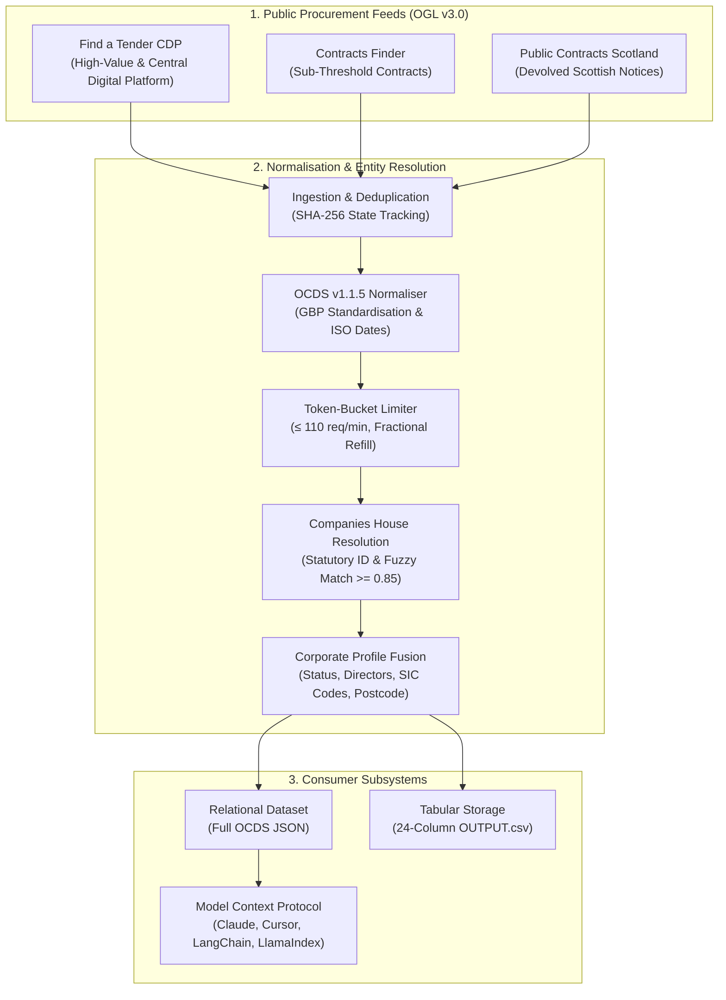

# UK Public Procurement Pipeline: OCDS v1.1.5 Normalisation & Companies House Resolution

[](LICENSE)
[](https://standard.open-contracting.org/1.1/en/)
[](examples/python/quickstart.py)
[](examples/typescript/quickstart.ts)
[](https://modelcontextprotocol.io)
[](https://apify.com/jamestyas/uk-public-procurement-ocds-enricher)

> Open-source data pipeline and client toolkit for aggregating UK public procurement notices across Find a Tender (CDP), Contracts Finder, and Public Contracts Scotland, normalised to the Open Contracting Data Standard (OCDS v1.1.5) and enriched with statutory Companies House corporate intelligence.

[Architecture & Pipeline](#architecture--data-pipeline) | [The Engineering Deep Dive](#the-engineering-deep-dive) | [Inspect Sample Data](samples/) | [Integration Examples](examples/) | [Model Context Protocol](#ai-agent--model-context-protocol-mcp-integration) | [Managed Execution (Apify)](#managed-cloud-runner-apify-actor)

---

## Overview

Public procurement in the United Kingdom exceeds £300 billion annually. Following the implementation of the Procurement Act 2023, the Cabinet Office centralised high-value notices on the Find a Tender Central Digital Platform (CDP). 

However, consuming raw procurement feeds presents severe data engineering hurdles:
1. **Unstandardised Supplier Identities**: Winning suppliers are recorded as arbitrary free-text strings (for example, "Cloud Ops Ltd", "Cloud Operations Limited", or "Cloud Operations UK") without canonical corporate identifiers.
2. **Missing Corporate Standing**: Raw government feeds do not verify whether an awarded vendor is an active trading entity, in liquidation, or dissolved. They also lack registered addresses, active officer lists, and statutory Standard Industrial Classification (SIC) trade activities.
3. **Devolution and Sub-Threshold Gaps**: Existing scrapers frequently query only Find a Tender, ignoring sub-threshold contracts on Contracts Finder or devolved regional notices on Public Contracts Scotland.

This project unifies all three statutory feeds under OCDS v1.1.5 specifications, resolves supplier entities against Companies House via an in-memory token-bucket rate limiter, and exposes the data via relational JSON datasets, flattened 24-column CSVs, and Model Context Protocol (MCP) endpoints for autonomous AI agents.

---

## Architecture & Data Pipeline

The pipeline queries all three statutory feeds concurrently, executes deduplication and schema normalisation, and resolves corporate identities against Companies House before dispatching to consumers:



---

## The Engineering Deep Dive

### 1. OCDS v1.1.5 Schema Normalisation & Cardinality

The Open Contracting Data Standard (OCDS v1.1.5) structures procurement into five sequential stages: planning, tender, award, contract, and implementation. However, relational transformation introduces distinct complexities:

- **Releases vs Compiled Records**: Procurement APIs emit discrete `releases` (event logs capturing notice creation, amendments, or award cancellations). To determine the definitive state of an award, historical releases must be collapsed into a unified `compiledRelease`. Naive overwriting loses amendment audit trails, while appending creates duplicate contract entries.
- **One-to-Many Cardinality Explosions**: A single procurement notice frequently contains one tender, multiple award tranches, dozens of line items, and a consortium of multiple winning suppliers. Exporting this tree directly to tabular CSV creates severe row duplication. The pipeline addresses this by producing a consolidated 24-column RFC 4180 format (`OUTPUT.csv`) where sub-arrays (such as SIC codes, CPV codes, and active directors) are serialised using deterministic semicolon delimiters.
- **Path Length and Schema Collisions**: Deeply nested OCDS paths (such as `contracts/implementation/milestones/documents/datePublished`) exceed identifier constraints in standard relational engines. The normaliser maps these into consistent top-level fields while preserving the verbatim nested payload in the relational JSON dataset.

### 2. Taming the Companies House API Quota

The official Companies House REST API provides corporate entity records, filing history, and officer appointments, but enforces strict boundary conditions:

- **The 600 Requests / 5-Minute Sliding Window**: The REST API quota is evaluated across a rolling 300-second window initiated by the first request. Unmetered concurrent requests consume 600 slots within seconds, causing subsequent calls to fail with `HTTP 429 (Too Many Requests)` and triggering mandatory stalls of up to 290 seconds.
- **In-Memory Token-Bucket Rate Limiter**: Rather than relying on coarse sleep intervals, the ingestion engine implements a token-bucket rate limiter with continuous fractional replenishment. The bucket capacity is bounded to 110 tokens per rolling 60,000ms window ($1.83\text{ tokens/sec}$), ensuring total volume never approaches the 600-request threshold:
  ```typescript
  // Continuous fractional refill calculation
  const now = this.clock();
  const elapsedMs = now - this.lastRefillTimestamp;
  if (elapsedMs > 0) {
    this.tokens = Math.min(this.capacity, this.tokens + (elapsedMs * this.refillRatePerMs));
    this.lastRefillTimestamp = now;
  }
  ```
- **Dynamic Header Inspection**: Requests track `X-Ratelimit-Limit`, `X-Ratelimit-Remain`, `X-Ratelimit-Reset`, and `X-Ratelimit-Window` on every HTTP response. If `X-Ratelimit-Remain` drops below 10, the limiter yields execution until the reset epoch expires.
- **Jurisdiction Quirks & Identifier Normalisation**:
  - **Leading Zeroes**: English and Welsh companies have 8-digit numerical identifiers. Exporting records through unquoted CSV pipelines frequently strips leading zeroes (e.g. `08912345` truncated to `8912345`). The normaliser automatically left-pads numerical strings with zeroes to ensure valid lookups.
  - **Devolved Jurisdiction Prefixes**: Scottish registered entities use the `SC` prefix (e.g. `SC123456`), Northern Irish entities use `NI`, and limited liability partnerships use `OC`. The matcher parses these statutory prefixes prior to executing exact or fuzzy string lookups.
  - **Fuzzy Match Threshold**: Free-text supplier names are cleaned (removing punctuation, corporate suffixes such as "LTD", "LIMITED", "PLC", and whitespace anomalies) before running Levenshtein distance scoring. Exact CRN matches receive a confidence score of `1.0`, while fuzzy candidate matches require a confidence $\ge 0.85$ to attach corporate intelligence.

---

## Output Formats & Data Specifications

Outputs are delivered in two formats:
1. **Relational Dataset (JSON)**: Structured objects combining top-level summary columns with the full nested OCDS v1.1.5 release payload.
2. **Tabular Storage (`OUTPUT.csv`)**: A 24-column flattened tabular CSV file formatted to RFC 4180 specifications.

### 24-Column Tabular CSV Specification (`OUTPUT.csv`)

| # | Column Name | Type | Description | Example Value |
|:---:|---|---|---|---|
| 1 | `ocid` | String | Open Contracting Data Standard identifier | `ocds-h6vhtk-045e7f-d8e2f9a1` |
| 2 | `source_platform` | String | Originating procurement platform | `find_a_tender` |
| 3 | `notice_type` | String | Notice lifecycle category | `award` |
| 4 | `status` | String | Procurement status | `complete` |
| 5 | `published_date` | String | Notice publication date in ISO 8601 UTC | `2026-11-10T14:30:00Z` |
| 6 | `deadline_date` | String | Submission deadline or empty if award | `2026-12-15T12:00:00Z` |
| 7 | `title` | String | Notice statutory title | `Cloud Infrastructure Migration` |
| 8 | `description` | String | Summary scope of the procurement | `Statutory cloud migration contract.` |
| 9 | `buyer_name` | String | Contracting authority name | `Department for Science, Innovation and Technology` |
| 10 | `buyer_id` | String | Statutory contracting authority identifier | `GB-GOVUK-DSIT` |
| 11 | `buyer_region` | String | Regional locality of the buyer | `London` |
| 12 | `supplier_name` | String | Winning supplier name | `Cloud Operations Limited` |
| 13 | `company_number` | String | Companies House registration number (8 digits) | `08912345` |
| 14 | `company_status` | String | Statutory company standing | `active` |
| 15 | `company_incorporation_date` | String | Incorporation date (`YYYY-MM-DD`) | `2014-02-18` |
| 16 | `registered_postcode` | String | Registered office postcode | `EC2A 4NE` |
| 17 | `sic_codes` | String | Semicolon-delimited industrial trade codes | `62020;62090` |
| 18 | `active_directors` | String | Semicolon-delimited roster with roles | `SMITH, John (director);DAVIES, Sarah (director)` |
| 19 | `award_value_gbp` | Decimal | Awarded contract value in GBP | `450000.00` |
| 20 | `tender_value_gbp` | Decimal | Estimated procurement budget in GBP | `450000.00` |
| 21 | `currency` | String | Standardised currency code | `GBP` |
| 22 | `cpv_codes` | String | Semicolon-delimited 8-digit CPV codes | `72000000;72222300` |
| 23 | `enriched` | Boolean | Corporate enrichment verification flag | `true` |
| 24 | `deduplication_hash` | String | Deterministic SHA-256 state tracking hash | `a4f89d31e9c20184b2e8812c759403d1...` |

Sample exports are directly inspectable in the repository:
- CSV: [samples/sample-output.csv](samples/sample-output.csv)
- JSON: [samples/sample-output.json](samples/sample-output.json)

---

## Client Quickstart & Integration Examples

The repository includes runnable client examples for Python, TypeScript, and AI agents.

### Python Quickstart

Install the dependency:

```bash
pip install apify-client
```

Execute a query:

```python
import os
from apify_client import ApifyClient

client = ApifyClient(os.getenv("APIFY_TOKEN", "YOUR_APIFY_TOKEN"))

run_input = {
    "sources": ["find_a_tender", "contracts_finder", "public_contracts_scotland"],
    "notice_type": "award",
    "min_value_gbp": 100000,
    "cpv_codes": ["72000000"],  # IT services
    "enrich_companies_house": True,
    "max_records": 25,  # First 25 records are free
}

run = client.actor("jamestyas/uk-public-procurement-ocds-enricher").call(run_input=run_input)
items = client.dataset(run["defaultDatasetId"]).list_items().items

for item in items[:3]:
    print(f"[{item.get('source_platform')}] {item.get('title')}")
    print(f"Buyer: {item.get('buyer_name')}")
    print(f"Value: £{item.get('award_value_gbp', 0):,.2f}")
    if item.get("enriched"):
        ch = item.get("supplier", {}).get("companies_house_match", {})
        print(f"Supplier: {item.get('supplier_name')} (CRN: {ch.get('company_number')})")
        print(f"Status: {ch.get('status')} | Postcode: {ch.get('registered_postcode')}")
    print("-" * 50)
```

Runnable script: [examples/python/quickstart.py](examples/python/quickstart.py).

---

### Node.js / TypeScript Quickstart

Install the dependency:

```bash
npm install apify-client
```

Execute a query:

```typescript
import { ApifyClient } from 'apify-client';

const client = new ApifyClient({
  token: process.env.APIFY_TOKEN || 'YOUR_APIFY_TOKEN',
});

async function run(): Promise<void> {
  const runInput = {
    sources: ['find_a_tender', 'contracts_finder', 'public_contracts_scotland'],
    notice_type: 'award',
    min_value_gbp: 100000,
    cpv_codes: ['72000000'],
    enrich_companies_house: true,
    max_records: 25,
  };

  const actorRun = await client.actor('jamestyas/uk-public-procurement-ocds-enricher').call(runInput);
  const { items } = await client.dataset(actorRun.defaultDatasetId).listItems();

  for (const item of items.slice(0, 3) as any[]) {
    console.log(`[${item.source_platform}] ${item.title}`);
    console.log(`Buyer: ${item.buyer_name}`);
    console.log(`Value: £${Number(item.award_value_gbp ?? 0).toLocaleString('en-GB')}`);
    if (item.enriched && item.supplier?.companies_house_match) {
      const match = item.supplier.companies_house_match;
      console.log(`Supplier: ${item.supplier_name} (CRN: ${match.company_number})`);
      console.log(`Status: ${match.status} | Postcode: ${match.registered_postcode}`);
    }
    console.log('--------------------------------------------------');
  }
}

run().catch(console.error);
```

Runnable script: [examples/typescript/quickstart.ts](examples/typescript/quickstart.ts).

---

## AI Agent & Model Context Protocol (MCP) Integration

The pipeline exposes native endpoints for autonomous AI coding agents and LLM frameworks through `@apify/actors-mcp-server`.

- **Tool Name**: `uk-public-procurement-ocds-enricher`
- **Hosted MCP Endpoint**: `mcp.apify.com`

### Claude Code CLI Setup

```bash
export APIFY_TOKEN="YOUR_APIFY_TOKEN"
claude mcp add apify -- npx -y @apify/actors-mcp-server
```

For Windows PowerShell:

```powershell
$env:APIFY_TOKEN="YOUR_APIFY_TOKEN"
claude mcp add apify -- npx -y @apify/actors-mcp-server
```

### Claude Desktop & Cursor Configuration

Ready-to-copy configurations are provided in the repository:
- Claude Desktop: [examples/mcp/claude_desktop_config.json](examples/mcp/claude_desktop_config.json)
- Cursor IDE: [examples/mcp/cursor_settings.json](examples/mcp/cursor_settings.json)

### Agent Frameworks
- LangChain integration: [examples/python/langchain_agent.py](examples/python/langchain_agent.py)
- LlamaIndex integration: [examples/python/llamaindex_agent.py](examples/python/llamaindex_agent.py)

---

## Low-Code Automations (Make & n8n)

Pre-built workflow templates allow ingesting procurement opportunities without writing code:
- **Make.com Scenario Blueprint**: [examples/automations/make-uk-tenders-blueprint.json](examples/automations/make-uk-tenders-blueprint.json)
- **n8n Community Workflow**: [examples/automations/n8n-uk-tenders-workflow.json](examples/automations/n8n-uk-tenders-workflow.json)
- Setup documentation: [examples/automations/README.md](examples/automations/README.md)

---

## Managed Cloud Runner (Apify Actor)

For production deployments requiring scheduled execution, proxy rotation, and zero local daemon management, the pipeline runs as a managed Apify Actor:
[https://apify.com/jamestyas/uk-public-procurement-ocds-enricher](https://apify.com/jamestyas/uk-public-procurement-ocds-enricher)

### Pay-Per-Event (PPE) Pricing

The Actor bills strictly on delivered records, with zero charges for idle intervals or compute duration:

| Tier | Unit Price | Rate per 1,000 Notices | Applicable Event |
|---|---|---|---|
| **Evaluation Free Allowance** | **$0.000** | **$0.00** | First 25 records on every execution run |
| **Standard Notice** | **$0.003** | **$3.00** | Un-enriched tenders, planning notices, or awards |
| **Enriched Notice** | **$0.008** | **$8.00** | Notices enriched with Companies House corporate intelligence |

### Hard Spending Caps
You can configure a hard spending limit in the Apify Console (for example, `$1.00`). If reached, the Actor flushes collected notices to storage, outputs `OUTPUT.csv`, saves deduplication state, and exits cleanly with code 0.

---

## Repository Structure

```
.
├── .gitignore                      # Git exclusion rules
├── LICENSE                         # MIT Licence
├── README.md                       # Architectural deep dive and technical documentation
├── package.json                    # Package metadata and dependencies
├── requirements.txt                # Python client dependencies
├── examples/
│   ├── automations/
│   │   ├── make-uk-tenders-blueprint.json  # Make.com scenario blueprint
│   │   ├── n8n-uk-tenders-workflow.json    # n8n community workflow
│   │   └── README.md                       # Low-code automation setup guide
│   ├── mcp/
│   │   ├── claude_desktop_config.json      # Claude Desktop MCP configuration
│   │   └── cursor_settings.json            # Cursor MCP configuration
│   ├── python/
│   │   ├── quickstart.py                   # Python client script
│   │   ├── langchain_agent.py              # LangChain structured tool
│   │   └── llamaindex_agent.py             # LlamaIndex function tool
│   └── typescript/
│       └── quickstart.ts                   # TypeScript client script
└── samples/
    ├── sample-output.json                  # Multi-platform OCDS JSON dataset export
    └── sample-output.csv                   # 24-column RFC 4180 CSV export
```

---

## Data Attribution & Licence

- **Software Licence**: Released under the [MIT Licence](LICENSE).
- **Public Sector Information**: Contains public sector data licensed under the [Open Government Licence v3.0](https://www.nationalarchives.gov.uk/doc/open-government-licence/version/3/):
  - Crown Commercial Service: Find a Tender and Contracts Finder.
  - Scottish Government: Public Contracts Scotland.
  - Companies House: Crown copyright material accessed via the official Companies House REST API.
