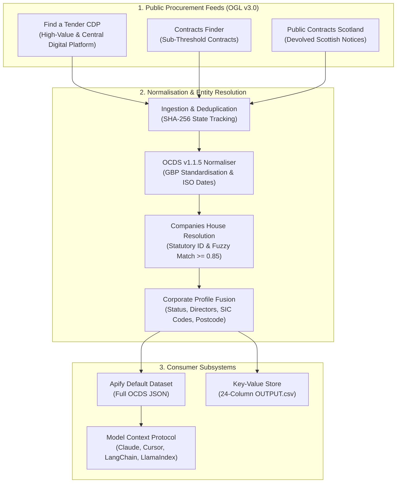

# UK Public Procurement API & MCP: Find a Tender, Contracts Finder & PCS Enriched Feed

[](https://apify.com/jamestyas/uk-public-procurement-ocds-enricher)
[](https://modelcontextprotocol.io)
[](LICENSE)
[](examples/python/quickstart.py)
[](examples/typescript/quickstart.ts)
[](https://standard.open-contracting.org/1.1/en/)

> Production-grade UK public procurement ingestion pipeline aggregating notices across Find a Tender (CDP), Contracts Finder, and Public Contracts Scotland (PCS), automatically enriched with Companies House corporate intelligence.

[Run on Apify Store](https://apify.com/jamestyas/uk-public-procurement-ocds-enricher) | [Inspect Sample Data](samples/) | [View Integration Examples](examples/) | [Model Context Protocol Setup](#ai-agent--model-context-protocol-mcp-integration)

---

## Overview

The `uk-public-procurement-ocds-enricher` Actor provides a unified UK Public Procurement API and Model Context Protocol (MCP) tool. It continuously aggregates procurement notices structured under the Open Contracting Data Standard (OCDS v1.1.5) and automates corporate due diligence by cross-referencing winning suppliers against the statutory Companies House register.

### Key Capabilities

- **Tri-Platform Ingestion**: Aggregates notices across the Find a Tender Central Digital Platform (Procurement Act 2023 compliant), Contracts Finder (sub-threshold central and local contracts), and Public Contracts Scotland (devolved Scottish notices under the Public Contracts Scotland Regulations 2015).
- **Statutory Corporate Intelligence**: Automatically resolves supplier names to official UK Companies House records, attaching registered company numbers, corporate status, incorporation dates, Standard Industrial Classification (SIC) codes, registered postcodes, and active directors.
- **Zero Scraping Fragility**: Connects directly to official REST and XML APIs published under the Open Government Licence (OGL v3.0), eliminating Document Object Model (DOM) scraping breakage.
- **Native AI Agent Compatibility**: Direct integration with `@apify/actors-mcp-server` allows autonomous agents in Claude Desktop, Cursor, LangChain, and LlamaIndex to query tenders without custom scraping logic.
- **Dual Export Formats**: Emits full relational OCDS JSON releases to the Apify Default Dataset and a 24-column RFC 4180 flattened tabular export (`OUTPUT.csv`) to the Key-Value Store.
- **Free Evaluation Allowance**: Every execution includes 25 free evaluation records, followed by predictable Pay-Per-Event (PPE) pricing.

---

## Why Automated Corporate Verification Matters

Public procurement in the United Kingdom exceeds £300 billion annually. Following the implementation of the Procurement Act 2023, the Cabinet Office centralised high-value notices on the Find a Tender Central Digital Platform (CDP).

However, raw procurement data presents three structural challenges for data analysts, procurement professionals, and software engineers:

1. **Unstandardised Supplier Identities**: Procurement notices record winning suppliers as free-text strings (for example, "Cloud Ops Ltd", "Cloud Operations Limited", or "Cloud Operations UK"). Without an official Companies House company registration number (CRN), matching contracts to corporate groups requires tedious manual investigation.
2. **Missing Corporate Standing**: Raw government feeds do not indicate whether an awarded vendor is an active trading entity, in liquidation, or dissolved. They also lack registered addresses, active officer lists, and statutory SIC trade activities.
3. **Devolution and Sub-Threshold Gaps**: Existing UK government contracts scrapers frequently focus only on Find a Tender, ignoring sub-threshold opportunities on Contracts Finder or devolved regional notices published on Public Contracts Scotland.

This Actor eliminates these gaps by querying all three statutory feeds concurrently and executing an automated two-stage entity resolution pipeline against the Companies House API:



---

## Quickstart

Run the Actor on Apify using Python, TypeScript, or raw cURL requests.

### Python Quickstart (`apify-client`)

Install the official client:

```bash
pip install apify-client
```

Execute a query:

```python
import os
from apify_client import ApifyClient

# Acquire your token from https://console.apify.com/account/integrations
client = ApifyClient(os.getenv("APIFY_TOKEN", "YOUR_APIFY_TOKEN"))

run_input = {
    "sources": ["find_a_tender", "contracts_finder", "public_contracts_scotland"],
    "notice_type": "award",
    "min_value_gbp": 100000,
    "cpv_codes": ["72000000"],  # IT services
    "enrich_companies_house": True,
    "max_records": 25,  # First 25 records are free
}

run = client.actor("jamestyas/uk-public-procurement-ocds-enricher").call(run_input=run_input)
items = client.dataset(run["defaultDatasetId"]).list_items().items

for item in items[:3]:
    print(f"[{item.get('source_platform')}] {item.get('title')}")
    print(f"Buyer: {item.get('buyer_name')}")
    print(f"Value: £{item.get('award_value_gbp', 0):,.2f}")
    if item.get("enriched"):
        ch = item.get("supplier", {}).get("companies_house_match", {})
        print(f"Supplier: {item.get('supplier_name')} (CRN: {ch.get('company_number')})")
        print(f"Status: {ch.get('status')} | Postcode: {ch.get('registered_postcode')}")
    print("-" * 50)
```

A complete runnable script is available at [examples/python/quickstart.py](examples/python/quickstart.py).

---

### Node.js / TypeScript Quickstart (`apify-client`)

Install the client:

```bash
npm install apify-client
```

Execute a query:

```typescript
import { ApifyClient } from 'apify-client';

const client = new ApifyClient({
  token: process.env.APIFY_TOKEN || 'YOUR_APIFY_TOKEN',
});

async function run(): Promise<void> {
  const runInput = {
    sources: ['find_a_tender', 'contracts_finder', 'public_contracts_scotland'],
    notice_type: 'award',
    min_value_gbp: 100000,
    cpv_codes: ['72000000'],
    enrich_companies_house: true,
    max_records: 25,
  };

  const actorRun = await client.actor('jamestyas/uk-public-procurement-ocds-enricher').call(runInput);
  const { items } = await client.dataset(actorRun.defaultDatasetId).listItems();

  for (const item of items.slice(0, 3) as any[]) {
    console.log(`[${item.source_platform}] ${item.title}`);
    console.log(`Buyer: ${item.buyer_name}`);
    console.log(`Value: £${Number(item.award_value_gbp ?? 0).toLocaleString('en-GB')}`);
    if (item.enriched && item.supplier?.companies_house_match) {
      const match = item.supplier.companies_house_match;
      console.log(`Supplier: ${item.supplier_name} (CRN: ${match.company_number})`);
      console.log(`Status: ${match.status} | Postcode: ${match.registered_postcode}`);
    }
    console.log('--------------------------------------------------');
  }
}

run().catch(console.error);
```

A complete runnable script is available at [examples/typescript/quickstart.ts](examples/typescript/quickstart.ts).

---

### cURL REST API

You can trigger execution and retrieve results using standard HTTP requests:

```bash
curl -X POST "https://api.apify.com/v2/acts/jamestyas~uk-public-procurement-ocds-enricher/runs?token=YOUR_APIFY_TOKEN" \
  -H "Content-Type: application/json" \
  -d '{
    "sources": ["find_a_tender", "contracts_finder"],
    "notice_type": "award",
    "min_value_gbp": 50000,
    "enrich_companies_house": true,
    "max_records": 25
  }'
```

To fetch items directly from a completed dataset:

```bash
curl -G "https://api.apify.com/v2/datasets/<DATASET_ID>/items" \
  -d "format=json" \
  -d "clean=true"
```

To download the 24-column CSV file directly from the Key-Value Store:

```bash
curl -O "https://api.apify.com/v2/key-value-stores/<KEY_VALUE_STORE_ID>/records/OUTPUT.csv"
```

---

## AI Agent & Model Context Protocol (MCP) Integration

The Actor exposes native endpoints for autonomous AI coding agents and LLM frameworks through `@apify/actors-mcp-server`.

- **Tool Name**: `uk-public-procurement-ocds-enricher`
- **Hosted MCP Endpoint**: `mcp.apify.com`

### Claude Code CLI Setup

To register the Actor with Claude Code, run the following command in your terminal:

```bash
# Set your Apify API token
export APIFY_TOKEN="YOUR_APIFY_TOKEN"

# Register the Apify MCP server with Claude Code
claude mcp add apify -- npx -y @apify/actors-mcp-server
```

For Windows PowerShell:

```powershell
$env:APIFY_TOKEN="YOUR_APIFY_TOKEN"
claude mcp add apify -- npx -y @apify/actors-mcp-server
```

The tool will be available as `uk-public-procurement-ocds-enricher`.

### Claude Desktop Configuration

Add the server to your Claude Desktop configuration file:
- macOS: `~/Library/Application Support/Claude/claude_desktop_config.json`
- Windows: `%APPDATA%\Claude\claude_desktop_config.json`

```json
{
  "mcpServers": {
    "uk-procurement": {
      "command": "npx",
      "args": [
        "-y",
        "@apify/actors-mcp-server"
      ],
      "env": {
        "APIFY_TOKEN": "YOUR_APIFY_TOKEN"
      }
    }
  }
}
```

A template file is available at [examples/mcp/claude_desktop_config.json](examples/mcp/claude_desktop_config.json).

---

### Cursor Configuration

In Cursor, open **Settings** -> **Features** -> **MCP Servers** -> **Add New MCP Server**, or add the following to `.cursor/mcp.json`:

```json
{
  "mcpServers": {
    "uk-procurement": {
      "command": "npx",
      "args": [
        "-y",
        "@apify/actors-mcp-server"
      ],
      "env": {
        "APIFY_TOKEN": "YOUR_APIFY_TOKEN"
      }
    }
  }
}
```

A template file is available at [examples/mcp/cursor_settings.json](examples/mcp/cursor_settings.json).

---

### LangChain & LlamaIndex Agent Tools

AI agents can treat the Actor as a structured tool to resolve procurement questions autonomously.

#### LangChain Example
See the complete implementation in [examples/python/langchain_agent.py](examples/python/langchain_agent.py).

#### LlamaIndex Example
See the complete implementation in [examples/python/llamaindex_agent.py](examples/python/llamaindex_agent.py).

#### Example Prompts for Autonomous Agents

Once configured in Claude or Cursor, you can issue natural-language queries:

- *"Find all cloud software and hosting contract awards over £250,000 published across the UK during the past fortnight. Detail the winning vendors, their Companies House registration numbers, and active directors."*
- *"Scan Public Contracts Scotland for open tenders in medical information systems published this month. What is the total estimated framework value?"*
- *"Check Contracts Finder for cyber security and penetration testing contracts awarded in London, and verify if the awarded suppliers are active UK companies."*

---

## Input Configuration Schema

The Actor accepts the following input parameters:

| Parameter | Type | Required | Default | Description | Example |
|---|---|:---:|---|---|---|
| `sources` | Array | **Yes** | `["find_a_tender", "contracts_finder", "public_contracts_scotland"]` | Procurement platforms to query. At least one platform must be selected. | `["find_a_tender", "contracts_finder"]` |
| `notice_type` | String | No | `"all"` | Lifecycle filter: `"all"`, `"tender"`, `"award"`, or `"modification"`. | `"award"` |
| `date_from` | String | No | 7 days prior to run | ISO 8601 calendar date (`YYYY-MM-DD`). Notices prior to this date are excluded. | `"2026-11-01"` |
| `date_to` | String | No | Current date | ISO 8601 calendar date (`YYYY-MM-DD`). Defaults to execution date. | `"2026-11-13"` |
| `min_value_gbp` | Integer | No | `0` | Minimum contract threshold in British Pounds (GBP). | `100000` |
| `cpv_codes` | Array | No | `[]` | Common Procurement Vocabulary codes (e.g. `72000000` for IT services). | `["72000000", "72222300"]` |
| `enrich_companies_house` | Boolean | No | `true` | Resolves supplier corporate intelligence against Companies House statutory records. | `true` |
| `max_records` | Integer | No | `100` | Maximum notices to output in a single run (minimum: 1, maximum: 5,000). | `250` |

---

## Output Formats & Data Specifications

Outputs are delivered in two formats:

1. **Default Dataset (JSON)**: Structured objects combining console summary columns with the full nested OCDS v1.1.5 release payload.
2. **Key-Value Store (`OUTPUT.csv`)**: A 24-column flattened tabular CSV file formatted to RFC 4180 specifications.

### 24-Column Tabular CSV Specification (`OUTPUT.csv`)

The tabular CSV file is available in the run's default Key-Value Store as `OUTPUT.csv`. Array fields are joined using semicolon delimiters.

| # | Column Name | Type | Description | Example Value |
|:---:|---|---|---|---|
| 1 | `ocid` | String | Open Contracting Data Standard identifier | `ocds-h6vhtk-045e7f-d8e2f9a1` |
| 2 | `source_platform` | String | Originating procurement platform | `find_a_tender` |
| 3 | `notice_type` | String | Notice lifecycle category | `award` |
| 4 | `status` | String | Procurement status | `complete` |
| 5 | `published_date` | String | Notice publication date in ISO 8601 UTC | `2026-11-10T14:30:00Z` |
| 6 | `deadline_date` | String | Submission deadline or empty if award | `2026-12-15T12:00:00Z` |
| 7 | `title` | String | Notice statutory title | `Cloud Infrastructure Migration` |
| 8 | `description` | String | Summary scope of the procurement | `Statutory cloud migration contract.` |
| 9 | `buyer_name` | String | Contracting authority name | `Department for Science, Innovation and Technology` |
| 10 | `buyer_id` | String | Statutory contracting authority identifier | `GB-GOVUK-DSIT` |
| 11 | `buyer_region` | String | Regional locality of the buyer | `London` |
| 12 | `supplier_name` | String | Winning supplier name | `Cloud Operations Limited` |
| 13 | `company_number` | String | Companies House registration number (8 digits) | `08912345` |
| 14 | `company_status` | String | Statutory company standing | `active` |
| 15 | `company_incorporation_date` | String | Incorporation date (`YYYY-MM-DD`) | `2014-02-18` |
| 16 | `registered_postcode` | String | Registered office postcode | `EC2A 4NE` |
| 17 | `sic_codes` | String | Semicolon-delimited industrial trade codes | `62020;62090` |
| 18 | `active_directors` | String | Semicolon-delimited roster with roles | `SMITH, John (director);DAVIES, Sarah (director)` |
| 19 | `award_value_gbp` | Decimal | Awarded contract value in GBP | `450000.00` |
| 20 | `tender_value_gbp` | Decimal | Estimated procurement budget in GBP | `450000.00` |
| 21 | `currency` | String | Standardised currency code | `GBP` |
| 22 | `cpv_codes` | String | Semicolon-delimited 8-digit CPV codes | `72000000;72222300` |
| 23 | `enriched` | Boolean | Corporate enrichment verification flag | `true` |
| 24 | `deduplication_hash` | String | Deterministic SHA-256 state tracking hash | `a4f89d31e9c20184b2e8812c759403d1...` |

A sample CSV export is available at [samples/sample-output.csv](samples/sample-output.csv).

---

### Dataset Record JSON Sample

The full JSON dataset item structure includes nested corporate intelligence and complete OCDS releases:

```json
{
  "ocid": "ocds-h6vhtk-045e7f-d8e2f9a1",
  "source_platform": "find_a_tender",
  "notice_type": "award",
  "status": "complete",
  "published_date": "2026-11-10T14:30:00Z",
  "deadline_date": null,
  "title": "Cloud Infrastructure Migration and Managed Services",
  "description": "Statutory cloud migration contract under the Procurement Act 2023.",
  "buyer_name": "Department for Science, Innovation and Technology",
  "buyer_id": "GB-GOVUK-DSIT",
  "buyer_region": "London",
  "supplier_name": "Cloud Operations Limited",
  "company_number": "08912345",
  "award_value_gbp": 450000.00,
  "tender_value_gbp": 450000.00,
  "currency": "GBP",
  "cpv_codes": [
    "72000000",
    "72222300"
  ],
  "lots_count": 1,
  "enriched": true,
  "deduplication_hash": "a4f89d31e9c20184b2e8812c759403d192a543ef810935cc23e4210d7a6e1903",
  "supplier": {
    "raw_name": "Cloud Operations Limited",
    "clean_name": "Cloud Operations Limited",
    "company_number": "08912345",
    "companies_house_match": {
      "company_number": "08912345",
      "company_name": "CLOUD OPERATIONS LIMITED",
      "status": "active",
      "company_type": "ltd",
      "sic_codes": [
        "62020",
        "62090"
      ],
      "incorporation_date": "2014-02-18",
      "registered_postcode": "EC2A 4NE",
      "registered_office_address": {
        "address_line_1": "10 Finsbury Square",
        "locality": "London",
        "postal_code": "EC2A 4NE",
        "country": "England"
      },
      "active_directors": [
        {
          "name": "SMITH, John Alexander",
          "officer_role": "director",
          "appointed_on": "2014-02-18"
        },
        {
          "name": "DAVIES, Sarah Jane",
          "officer_role": "director",
          "appointed_on": "2016-09-01"
        }
      ],
      "match_confidence": 1.0,
      "matched_by": "statutory_id",
      "matched_at": "2026-11-10T14:31:02.145Z"
    }
  },
  "ocds_release": {
    "ocid": "ocds-h6vhtk-045e7f-d8e2f9a1",
    "id": "ocds-h6vhtk-045e7f-d8e2f9a1-01",
    "date": "2026-11-10T14:30:00Z",
    "tag": [
      "award"
    ],
    "initiationType": "tender",
    "language": "en"
  }
}
```

A complete multi-platform JSON dataset is available at [samples/sample-output.json](samples/sample-output.json).

---

## Pay-Per-Event (PPE) Pricing

The Actor uses Apify's Pay-Per-Event (PPE) billing model. You pay strictly for data delivered, with zero charges for elapsed compute or idle intervals.

| Tier | Unit Price | Rate per 1,000 Notices | Applicable Event |
|---|---|---|---|
| **Evaluation Free Allowance** | **$0.000** | **$0.00** | First 25 records on every single execution run |
| **Standard Notice** | **$0.003** | **$3.00** | Un-enriched tenders, planning notices, or awards without corporate match |
| **Enriched Notice** | **$0.008** | **$8.00** | Notices enriched with Companies House corporate intelligence |

### Budget Protection & Graceful Completion

You can configure a hard spending cap in the Apify Console (for example, `$1.00`). If that spending limit is reached during a run, the Actor does not crash or discard records. It flushes all collected notices to the dataset, writes `OUTPUT.csv` to the Key-Value Store, saves the deduplication state, and exits with code 0.

---

## Repository Structure

```
.
├── .gitignore                      # Git exclusion rules for Node, Python, and credentials
├── LICENSE                         # MIT Licence
├── README.md                       # Repository overview and technical documentation
├── docs/
│   ├── APIFY_STORE_LISTING.md      # Store listing copy archive
│   ├── DEVELOPER.md                # Development, test suite, and deployment guide
│   └── ONBOARDING.md               # Credential configuration and Companies House guide
├── examples/
│   ├── mcp/
│   │   ├── claude_desktop_config.json  # Ready-to-copy Claude Desktop MCP configuration
│   │   └── cursor_settings.json        # Ready-to-copy Cursor MCP configuration
│   ├── python/
│   │   ├── quickstart.py           # Minimal runnable apify-client script
│   │   ├── langchain_agent.py      # LangChain structured tool integration
│   │   └── llamaindex_agent.py     # LlamaIndex function tool integration
│   └── typescript/
│       └── quickstart.ts           # Minimal runnable TypeScript script
└── samples/
    ├── sample-output.json          # Sanitised multi-platform OCDS JSON dataset export
    └── sample-output.csv           # 24-column RFC 4180 CSV export matching production
```

---

## Data Attribution & Licence

- **Software Licence**: Released under the [MIT Licence](LICENSE).
- **Public Sector Information**: Contains public sector data licensed under the [Open Government Licence v3.0](https://www.nationalarchives.gov.uk/doc/open-government-licence/version/3/):
  - Crown Commercial Service: Find a Tender and Contracts Finder.
  - Scottish Government: Public Contracts Scotland.
  - Companies House: Crown copyright material accessed via the official Companies House REST API.
