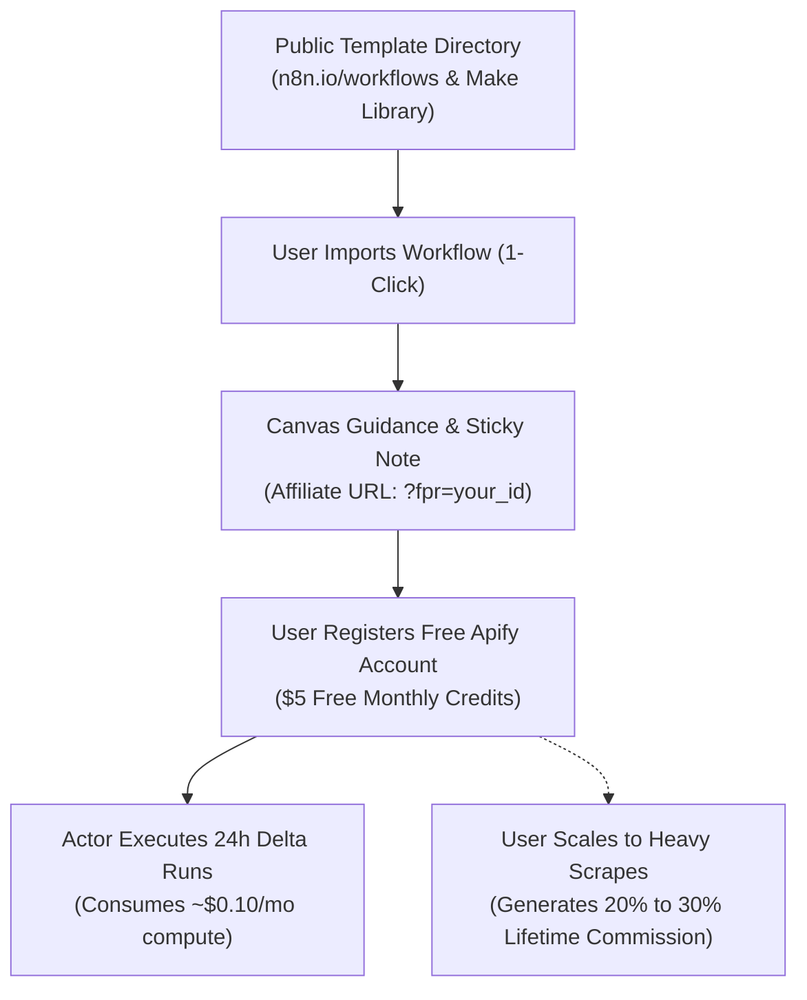

# UK Public Procurement Low-Code Automation Templates

This directory provides ready-to-import automation workflows for **n8n** and **Make.com**. These templates automatically query the `uk-public-procurement-ocds-enricher` Apify Actor daily at 08:00 UTC, filter high-value opportunities (£100k+), deduplicate records, and route alerts into a Google Sheet and Slack channel.

---

## Included Templates

1. `n8n-uk-tenders-workflow.json`: Complete n8n workflow export using the `@apify/n8n-nodes-apify` community node and built-in cross-execution deduplication memory.
2. `make-uk-tenders-blueprint.json`: Make.com scenario blueprint configured with synchronous Actor polling and Google Sheets lookup deduplication.

---

## 1. Quickstart: n8n Workflow

### Prerequisites
1. **Apify Account & API Token**: Sign up via `https://apify.com/store?fpr=YOUR_AFFILIATE_ID` (includes \$5/month in recurring free platform usage credits). Copy your API token from **Console -> Settings -> Integrations**.
2. **Apify n8n Node**:
   - In n8n Cloud: Search for `Apify` in the node browser and install it.
   - In Self-Hosted n8n: Navigate to **Settings -> Community Nodes -> Install** and enter `@apify/n8n-nodes-apify`.
3. **Google Sheets & Slack Credentials**: Standard OAuth2 / Webhook connections in your n8n workspace.

### Import Instructions
1. Open your n8n canvas.
2. Copy the contents of [`n8n-uk-tenders-workflow.json`](file:///e:/Development/marketplace-money/examples/automations/n8n-uk-tenders-workflow.json) to your clipboard.
3. Paste directly onto the canvas (`Ctrl+V` or `Cmd+V`).
4. Double-click the **Apify - Run Procurement Actor** node:
   - Select your Apify API credential.
   - Update `actorId` with your target Actor handle.
5. Connect your Google Sheets spreadsheet ID and Slack alert channel.
6. Toggle the workflow to **Active**.

---

## 2. Quickstart: Make.com Blueprint

### Prerequisites
1. An active Make.com workspace.
2. An Apify connection configured with your API token.
3. A Google Sheet with the following headers in row 1:
   `OCID`, `Published Date`, `Estimated Value (GBP)`, `Authority Name`, `Notice Title`, `Submission Deadline`, `Source Portal`, `Buyer Region`.

### Import Instructions
1. In Make.com, create a new scenario.
2. In the bottom toolbar, click the three dots (`...`) and select **Import blueprint**.
3. Upload [`make-uk-tenders-blueprint.json`](file:///e:/Development/marketplace-money/examples/automations/make-uk-tenders-blueprint.json).
4. Re-link your connections for Apify, Google Sheets, and Slack.
5. Save the scenario and enable scheduling.

---

## 3. Growth & Monetisation Funnel Architecture

These templates serve as direct acquisition engines for the underlying Apify Actor:

### Growth Tactics
- **Cross-Link in Store Description**: Link to these templates in the Apify Actor README under an "Automation & Low-Code" heading.
- **n8n Creator Hub Submission**: Submit `n8n-uk-tenders-workflow.json` to `n8n.io/creators` to appear in the official n8n workflow catalogue.
- **Make Public Scenario Link**: In the Make Scenario builder, click **Share -> Public scenario page** to generate a direct 1-click clone link for marketing campaigns.
